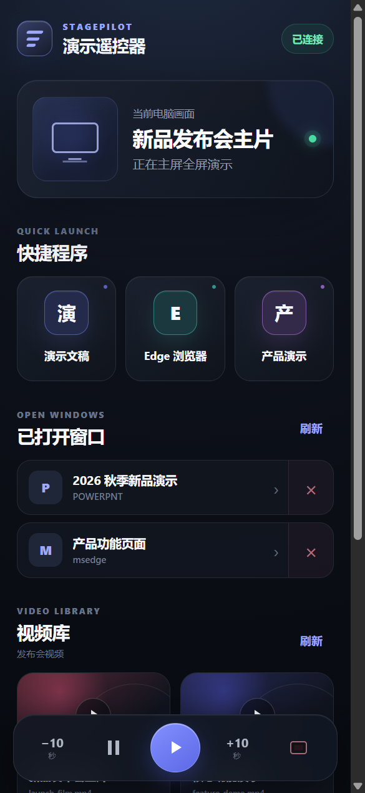

# StagePilot

手机控制 Windows 主屏演示的开源工具。StagePilot 在电脑端运行控制服务，手机通过同一局域网打开响应式网页，远程切换程序、当前窗口和本地视频。

切换程序时，StagePilot 会先保留当前主屏画面，在目标窗口准备、恢复和激活完成后再揭示新画面，从而减少启动窗口、窗口放大和桌面闪烁。它还针对 Windows 置顶 Unity 窗口加入了专门的层级处理与失败回滚。



## 使用场景

### 展厅与数字大屏

工作人员可以拿着手机在观众区切换 Unity 展示程序、网页、视频和其他全屏内容，无需回到电脑操作，也不会把桌面整理过程暴露在大屏上。

### 新品发布会与路演

演讲者可以按流程依次打开产品页面、演示程序和宣传视频。目标内容准备期间继续显示上一画面，适合需要连贯节奏的现场演示。

### 培训课堂

讲师离开讲台后仍可在手机上切换课件、浏览器和教学视频，并控制视频暂停、继续、音量及前后跳转。

### 会议汇报

会议主持人可以快速调出已经打开的窗口，在多个汇报材料之间切换，也可以从手机关闭指定窗口或使用安全黑屏。

### 企业宣传片与视频轮播

将多个视频放入指定文件夹，手机端会生成视频列表。点击视频后，电脑主屏在媒体可播放时直接进入全屏播放。

### Unity 交互项目演示

针对使用 `HWND_TOPMOST` 的 Unity Windows 程序，StagePilot 会在保留画面的遮罩下暂时释放其置顶状态并切换到浏览器；切回 Unity 时恢复原置顶状态和自定义窗口尺寸。

## 主要功能

- 手机网页适配竖屏、横屏与安全区
- 设置连接密码、视频文件夹和快捷程序
- 启动准备检查与运行错误提示
- 自动发现 Edge、Chrome 和 Firefox
- 切换已配置程序或当前已打开窗口
- 本地视频预加载、全屏播放、暂停、跳转和音量控制
- 切换过程中保持上一画面，可配置目标窗口等待时间
- 兼容置顶 Unity 窗口，并在失败或退出时恢复窗口状态
- 关闭指定窗口、安全黑屏和远程退出电脑端管控
- WebSocket 实时状态与断线重连
- PBKDF2 密码校验和一次性登录挑战
- 损坏配置安全回退与原文件保留

## 工作方式

```text
手机浏览器
   │  HTTP / WebSocket（局域网）
   ▼
StagePilot 控制服务
   ├─ 窗口控制：启动、枚举、激活、关闭、Unity 置顶恢复
   ├─ 保持画面：截图遮罩覆盖准备过程
   └─ 视频输出：Chromium 双播放器预加载与全屏呈现
```

所有窗口操作都在电脑本机完成。网页端只收到公开状态、程序名称和媒体列表，不会获得本地文件路径。

## 系统要求

- Windows 10 或 Windows 11（64 位）
- Node.js 22 或更高版本（仅源码运行和构建需要）
- 手机与电脑位于同一个可信局域网

## 从源码运行

```powershell
git clone https://github.com/2809728882/StagePilot.git
cd StagePilot
npm install
npm start
```

首次启动后：

1. 查看“演示准备状态”，完成连接密码、视频文件夹和快捷程序配置。
2. 用手机扫描二维码，在手机网页输入连接密码。
3. 点击程序、窗口或视频开始控制主屏。
4. 如果目标程序启动较慢，在“切换设置”中增加等待时间。

安装版默认扫描当前用户的 Windows“视频”文件夹。支持 `.mp4`、`.m4v`、`.mov`、`.webm`、`.mkv`、`.avi`、`.mpeg` 和 `.mpg`。兼容性最好的是 MP4/H.264 和 WebM。

## 构建 Windows 安装包

```powershell
npm install
npm run check
npm test
npm run dist
```

安装程序生成在 `dist` 目录中。

推送 `v*` 标签后，GitHub Actions 会完成检查、测试、Windows 安装包构建并创建对应 Release；也可以在 Actions 页面手动运行构建并下载产物。

## 测试

```powershell
npm run check
npm test
```

Windows 原生窗口层级回归测试：

```powershell
$env:STAGEPILOT_NATIVE_TEST='1'
npm test
```

原生测试创建项目自有的测试窗口，验证置顶让出、焦点切换、尺寸恢复、遮罩顺序、失败回滚、退出恢复以及非 Unity 窗口不受影响。

## 安全与隐私

- 密码只保存 PBKDF2 派生校验值，不保存明文。
- 修改密码会轮换配对令牌并断开旧连接。
- 控制 API、媒体读取和实时连接都要求配对令牌。
- 媒体文件路径不会发送到手机端。
- 项目设计用于可信局域网，请勿将控制端口直接映射到公网。
- 发布仓库不包含演示视频、Unity 程序、测试日志、浏览器资料、配对令牌或电脑端用户配置。

更完整的产品需求与路线图见 [docs/PRODUCT_REQUIREMENTS.md](docs/PRODUCT_REQUIREMENTS.md)。

## 贡献

欢迎提交 Issue 和 Pull Request，开发流程见 [CONTRIBUTING.md](CONTRIBUTING.md)。安全问题请阅读 [SECURITY.md](SECURITY.md)。

版本变化记录见 [CHANGELOG.md](CHANGELOG.md)。

## 许可证

[MIT License](LICENSE)
